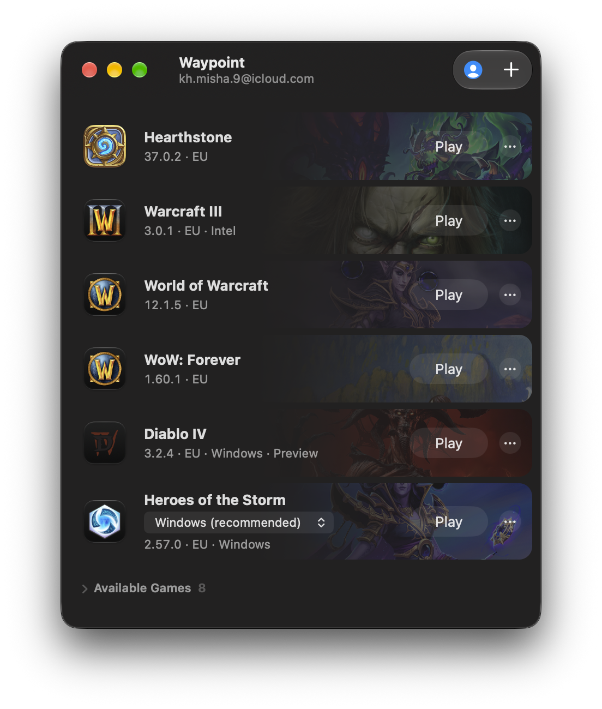
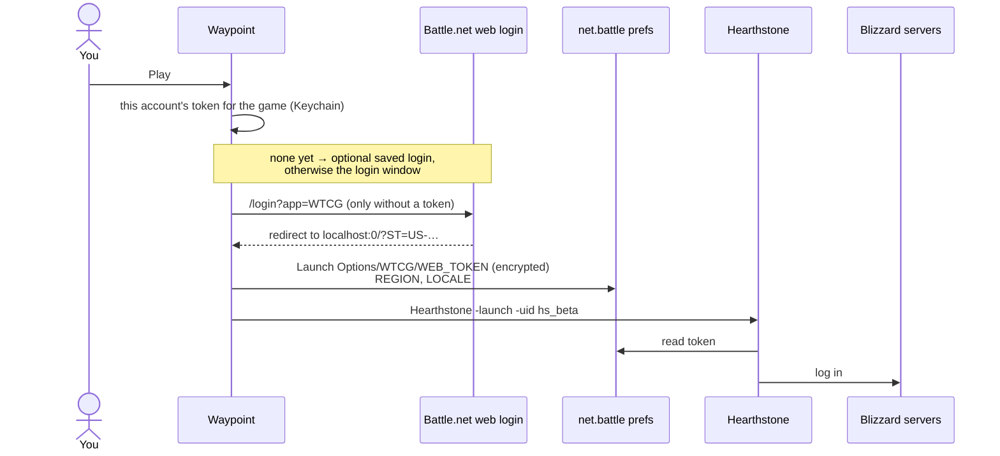

<div align="center">


# Waypoint

**A bloat-free version of Battle.net for Apple Silicon Macs.**<br>Install, update and launch Blizzard games without the Battle.net app. The launcher runs natively. Just press Play.

<a href="https://github.com/wowlocal/waypoint-launcher/releases/latest"></a>

[](https://github.com/wowlocal/waypoint-launcher/releases/latest) [](#build) [](#why) [](#build) [](#disclaimer)



**English** · [Русский](README.ru.md)

</div>

---

## Why

A launcher should install your games, keep them up to date, and sign you in. Waypoint does that in a native Swift and AppKit window, with downloads straight from Blizzard and no Battle.net app or Agent needed to play.

The launcher runs on Apple silicon. Mac games use their own executables; supported Windows editions use an optional Wine runtime. Each game keeps its own OS, Rosetta and account requirements.

| | Waypoint |
|---|---|
| Architecture | Native arm64, AppKit |
| App size | **9.6 MB**; about 4.5 MB to download |
| Windows components | Downloaded on demand and reused |
| Menu bar item | Off by default; enabled in Settings |

## Features

- **Your library in one window.** Installed games appear above a collapsible **Available Games** list. Install from there or the **+** button. Pictures and icons come from Blizzard's catalog; turn off **Show game artwork** in Settings to remove them and delete the downloaded artwork.
- **Install, update and repair.** Download directly from Blizzard, update games installed by either launcher, and use **Verify Files** to repair missing or corrupt content. Existing optional content, such as WoW's HighRes textures, is preserved.
- **Downloads you can leave and resume.** Installs, updates and language changes survive quitting, crashes and Waypoint updates. Pause and resume in the game's row, set a shared speed limit, or keep the Mac awake for a download. Hover over progress for speed, exact sizes and estimated time left.
- **Sign in once per game.** Use the official Battle.net web login, including two-factor authentication. Each saved account keeps its own sign-ins. Switch accounts or use **Play As** for a single launch; optionally save a login in Keychain.
- **Choose a WoW account.** Pick a license under **WoW Account** in a WoW game's menu; each edition remembers its own. With a single license, it's picked for you. Americas only for now. [Details](docs/wow-accounts.md).
- **Windows Heroes of the Storm.** The Windows edition is recommended on supported Macs, with the macOS edition selectable in the same row. It uses a free Wine component; CrossOver is not required. Windows HotS needs Rosetta and macOS 15+.
- **More Windows games in Preview.** Overwatch, Diablo IV and Diablo II: Resurrected use the same library and web login. They need Apple silicon, Rosetta and macOS 26.5+. Wine and graphics components download on demand; graphics installation asks you to accept its license. See the checks and limits below.
- **Choose languages.** Pick text and speech languages when installing, or use **Change Language…** later. WoW supports separate text and speech choices.
- **Manage game files.** Open a game in Finder or its WoW AddOns folder from **…**. **Uninstall…** moves game files to the Trash and can keep add-ons, settings and saved games. WoW editions sharing a folder can be removed separately.
- **Discovers games and new Mac releases.** Read existing Battle.net installs or scan game folders. Blizzard's catalog supplies current Mac editions, names, folders and launch settings, including new WoW editions. The catalog is cached for offline use. Completed native installs get missing Battle.net records repaired in the background, so Battle.net can recognize them too.
- **Small, native interface.** Library scans, metadata repair and artwork preparation run in the background. Large download manifests and indexes are read from disk rather than loaded into memory. Game files and login hand-offs follow Blizzard's formats.
- **Updates itself quietly.** [Sparkle](https://sparkle-project.org) downloads Waypoint updates in the background and installs them when you quit. **Restart to Update** is available in the window footer. Optional menu bar quick launch is enabled in Settings (⌘,).

## Supported games

Status combines the developer's hands-on testing with usage logs through **11 November 2026**. ✅ means tested; 🧪 means available but not yet tested. Windows Preview labels match those in the app.

| Game | Install | Launch | Updates |
|---|---|---|---|
| Hearthstone | ✅ Through Waypoint | ✅ Native | ✅ Through Waypoint |
| Warcraft III: Reforged | ✅ File set checked against Battle.net | ✅ Under Rosetta | ✅ Real build update |
| WoW: Retail | ✅ Full installation | ✅ Native | ✅ Multiple real build updates |
| WoW: Forever | ✅ Full installation | ✅ Native | ✅ Multiple real build updates |
| WoW: Classic Era | ✅ Through Waypoint | ✅ Native | ✅ Through Waypoint |
| WoW: Classic, Anniversary | 🧪 Not yet checked | 🧪 Not yet checked | 🧪 Not yet checked |
| Heroes of the Storm (macOS) | ✅ Through Waypoint | ✅ Under Rosetta | ✅ Through Waypoint |
| Heroes of the Storm (Windows) | ✅ Through Waypoint | ✅ Wine/DXMT | ✅ Through Waypoint |
| StarCraft II, StarCraft: Remastered, Diablo III | 🧪 Not yet checked | 🧪 Not yet checked | 🧪 Not yet checked |
| Overwatch (Windows Preview) | ✅ Full installation | ✅ Wine/D3DMetal | ✅ Through Waypoint |
| Diablo IV (Windows Preview) | ✅ Full installation | ✅ Wine/D3DMetal | ✅ Real build update |
| Diablo II: Resurrected (Windows Preview) | 🧪 Not yet checked | 🧪 Not yet checked | 🧪 Not yet checked |

<details>
<summary><b>Completed real build updates</b></summary>

These are completed updates recorded in Waypoint's usage logs, rather than dry runs or same-build repairs:

| Game | Completed update | Date |
|---|---|---|
| WoW: Retail | `12.1.5.70448 → 12.1.5.70529`, then `70688` and `70783` | 23 October – 4 November 2026 |
| WoW: Forever | `1.60.1.70790 → 1.60.1.70862 → 1.60.1.70888` | 7–11 November 2026 |
| Warcraft III | `3.0.0.24268 → 3.0.1.24371` | 10 November 2026 |
| Diablo IV (Windows) | `3.2.3.73883 → 3.2.4.74043` | 11 November 2026 |

</details>

Blizzard's ownership and account requirements still apply, including Overwatch SMS Protect where required. [Release notes](https://github.com/wowlocal/waypoint-launcher/releases) describe changes and earlier validation.

## Download

Get **Waypoint-x.y.z.dmg** from [Releases](https://github.com/wowlocal/waypoint-launcher/releases/latest), open it, and drag Waypoint to Applications. Releases are signed with a Developer ID and notarized by Apple, so the app opens without warnings.

Requires an Apple Silicon Mac with macOS 14 or later.

## Build

Requires macOS 14+ and Xcode with Swift 6.

```sh
git clone https://github.com/wowlocal/waypoint-launcher.git
cd waypoint-launcher
./scripts/bundle.sh          # → build/Waypoint.app
open build/Waypoint.app
```

Move `Waypoint.app` to `/Applications` if you want to keep it.

The local build includes Windows support when a runtime or download descriptor is staged at `build/windows-runtime-release/distribution`. See the [runtime build instructions](tools/wine-runtime/README.md) to prepare it. Without that component, the local build supports Mac games.

Published releases already include the download descriptors. The Windows runtime downloads on the first Windows Play and is reused from its verified cache; it is not bundled into every Waypoint update. Windows HotS needs macOS 15+, Apple silicon and Rosetta. The other Windows profiles need macOS 26.5+ and retain their Preview labels.

`WINDOWS_EXPERIMENTAL=1` creates an isolated development app with a separate bundle identifier and no public update feed. See [profiles, components and qualification status](tools/wine-runtime/WINDOWS-TITLES.md).

<details>
<summary><b>Making a release</b></summary>

`scripts/release.sh` runs the tests, then builds the app and signs it with your Developer ID (hardened runtime). It notarizes and staples the app, then packs it into a DMG and signs, notarizes and staples that too. It checks the result with Gatekeeper, then writes the Sparkle `appcast.xml` and verifies its EdDSA signature.

With `--publish`, the DMG and `appcast.xml` go to S3 (`storage.yandexcloud.net/macos-releases/waypoint/`), which is the update feed installed copies read, and the DMG is mirrored as a GitHub release. S3 credentials come from `AWS_ACCESS_KEY_ID`/`AWS_SECRET_ACCESS_KEY` or a gitignored `scripts/release.env`.

```sh
# use the existing notary keychain profile (the release script defaults to this)
export NOTARY_KEYCHAIN_PROFILE=keys-cli-notary
# …or use an App Store Connect API key instead: NOTARY_KEY=<.p8> NOTARY_KEY_ID=<id> NOTARY_ISSUER=<uuid>

scripts/release.sh 0.1.0             # → dist/Waypoint-0.1.0.dmg + .sha256
scripts/release.sh 0.1.0 --publish   # also tags v0.1.0 and creates the GitHub release

scripts/test-self-update.sh          # end-to-end: an old build updates itself from a local feed
```

Updates are signed with an EdDSA key kept in the keychain under the account `waypoint`. Its public half is in `scripts/bundle.sh`. Back it up somewhere safe: without it, installed copies can't be updated.

```sh
.build/artifacts/sparkle/Sparkle/bin/generate_keys --account waypoint -x waypoint-sparkle.key   # export
.build/artifacts/sparkle/Sparkle/bin/generate_keys --account waypoint -f waypoint-sparkle.key   # import on another Mac
```

</details>

## Usage

1. Open Waypoint. Games already on disk appear in the library. To install one, expand **Available Games** and click **Install**, or use **+** in the toolbar.
2. Choose the folder, language and region. The install sheet shows the download size and any data already available to reuse.
3. Press **Play**. Sign in through Battle.net's web page when asked. Each game asks once per account; later launches reuse its saved sign-in.

The window subtitle shows the active account. Use the person button to switch accounts, **Add Account…**, **Sign In Again…** or **Sign Out**. **Play As** in a game's **…** menu launches it once as another account. If a game rejects its sign-in, close it and use **Sign In Again and Play**.

<details>
<summary><b>Optional automatic login</b></summary>

Choose **Save Login in Keychain…** in the account menu, or **Save Login…** in Settings, to save that account's email/phone and password on this Mac. When a game has no saved token, Waypoint tries those credentials once. **Sign In Again and Play** also tries them with a fresh session. Passwords stay in Keychain, outside preferences and diagnostics.

Rejected logins, CAPTCHA and two-factor prompts open the Battle.net page for you to continue. **Update Saved Login…** replaces the saved credentials and enables automatic login again; **Forget Saved Login** or Sign Out removes them. Temporary failures use increasing delays, with automatic attempts paused after three consecutive failures. Attempts happen only when you launch a game, and the limit survives app restarts.

</details>

**Downloads.** Pause beside the progress bar; **Pausing…** lasts until requests and file writes stop. Resume keeps the original folder, languages, region and verification options. After quitting or updating Waypoint, unfinished jobs return **Paused** with their saved progress. Temporary network failures retry automatically. Hover over progress for recent speed, downloaded and total bytes, remaining size, and an estimated time when available.

The cup button keeps the Mac awake while that download runs, while allowing the display to sleep. It starts off for each new download. Pausing, an error or completion releases the sleep hold; resuming restores it if still enabled. Choosing Sleep or closing the lid still follows macOS's normal behavior.

Use **✕** on a paused or failed download to stop tracking it. An unfinished installation offers **Keep Downloaded Data** or **Move to Trash** when cleanup is safe. Installed games and shared data are protected; cancelling an update keeps its downloaded data. Keeping data lets a later install into the same folder reuse it.

**Settings** (⌘,) offers a combined download limit from **250 KB/s** to **100 MB/s**, or **Unlimited**. It also controls game artwork and the optional menu bar item. Turning artwork off removes its downloaded files; turning it on downloads them again (about 7 MB).

**The game's … menu** also offers:

- **Play Without Updating**, when an update is waiting.
- **Verify Files**, to check and repair game content.
- **Change Language…**, to download a new text or speech language.
- **Show in Finder**, plus **Open AddOns Folder** for a WoW edition whose folder exists. These work while the game runs too.
- **Uninstall…**, with a confirmation and an option to keep WoW add-ons, settings and screenshots, or a Windows game's saved games and settings. Other WoW editions stay installed; shared storage is cleaned only of content they no longer need.

> [!NOTE]
> Quit Battle.net and its background Agent before installing, updating or uninstalling. Waypoint prevents concurrent writes to the same game files. An active game must also be closed before changing its files.

For a bug report, choose **Help → Export Diagnostics…**. The export includes installation state and recent logs, with credentials and authentication tickets redacted. **Help → Show Logs in Finder** opens the local logs.

## How it works

On macOS, Battle.net doesn't pass the login to a game on the command line. It writes an encrypted token into the `net.battle` preferences domain and starts the game, and the game reads the token on startup. Waypoint does the same.



<details>
<summary><b>The details</b></summary>

**Preferences** (`~/Library/Preferences/net.battle.plist`)

| Key | Value |
|---|---|
| `Launch Options/<CODE>/WEB_TOKEN` | encrypted token (data) |
| `Launch Options/<CODE>/REGION` | `EU`, `US`, `KR`, `CN` |
| `Launch Options/<CODE>/LOCALE` | `enUS`, `ruRU`, … |

`<CODE>` is `WTCG` for Hearthstone and `WoW` for every WoW flavor.

**Encryption.** AES-128-CBC with a zero IV and PKCS#7 padding. The key is PBKDF2-HMAC-SHA1 (1000 rounds, salt `someSalt`) over a fixed 16-byte entropy XORed with the macOS user name. This mirrors `RegistryDarwin` in the game's Battle.net SDK. It was checked against tokens written by the real Battle.net app (`waypoint-cli check-tokens`).

**Token.** The Battle.net web login at `https://<region>.battle.net/login/en/?externalChallenge=login&app=<CODE>` finishes with a redirect to `http://localhost:0/?ST=<token>`. The token looks like `US-<32 hex>-<account id>`.

**Accounts.** Each account has its own persistent WebKit data store (`WKWebsiteDataStore(forIdentifier:)`), so their Battle.net sessions sit side by side. The token per account and game is kept in the login keychain and reused for later launches until it needs to be replaced. Switching accounts selects that account's saved sign-in for the game. The BattleTag and email come from the JSON API behind Blizzard's account page (`account.battle.net/api/details`), read with that account's session.

**Launch commands**

| Game | Command | Working directory |
|---|---|---|
| Hearthstone | `Hearthstone.app/…/Hearthstone -launch -uid hs_beta` | install folder |
| WoW | `World of Warcraft.app/…/World of Warcraft -launcherlogin -uid wow` | flavor folder (`_retail_`, `_classic_`, …) |
| Warcraft III, StarCraft | `<Game>.app/…/<Game> -launch -uid <uid>` | install folder (Warcraft III: `_retail_`) |
| StarCraft II, Heroes of the Storm | game switcher with `-sso=1 -launch -uid <uid>` | install folder |
| Diablo III | `Diablo III.app/…/Diablo III OnlineService.SSO=true -launch -uid d3` | install folder |

Launch arguments come from Blizzard's product configuration, with bundled defaults for offline use. Windows titles use a per-game Wine environment and a small helper to write their encrypted login options; their profiles and graphics requirements are documented [here](tools/wine-runtime/WINDOWS-TITLES.md).

Games are started with `posix_spawn` and disclaim the launcher as their responsible process, like apps started by Battle.net. So privacy prompts, such as the microphone for WoW voice chat, belong to the game.

**Updates** use Blizzard's content delivery protocol (TACT):

1. Ask `https://<region>.version.battle.net/v2/products/hsb/versions` which build is live.
2. Fetch that build's config and *install manifest* from the CDN. The manifest lists every file with its MD5 and tags (platform, region, language, content).
3. Select files with the tags Battle.net recorded for your install. The selection follows the installation's platform, region, languages and optional content.
4. Diff against the installed build's manifest. Only files whose hash changed are downloaded. Without the old manifest, local files are hashed instead (this is what **Verify Files** does).
5. Look up each file's encoded key in the *encoding* table and its location in the CDN archive indexes, then download it with an HTTP range request, decode the BLTE container chunk by chunk, and check the MD5.
6. Once every file is downloaded and verified, swap them in, then delete the files the new build no longer has.

Downloads are staged in `.waypoint-staging` inside the game folder, so an interrupted update resumes where it stopped. Updating refuses to run while the game is open.

**Installs.** Hearthstone keeps its files loose, so installing it is an update into an empty folder. Every other game keeps its data in local CASC storage (`Data/data`), which the game reads itself. Waypoint downloads the files the build's download manifest lists for your platform and language, and writes the `data.###` archives, the 16 `.idx` index files and `shmem` byte for byte the way the Battle.net Agent does. The app and the other files from the install manifest go loose into the game folder, next to `.build.info`, `Data/config` and `Data/indices` (every index the CDN config names, plus the two archive-group indexes Battle.net builds from them, byte for byte as it does). A Warcraft III test install matched Battle.net's file set and launched successfully.

**Updates of these games** add the new build's files to the same storage, whoever wrote it. Nothing already there is moved or rewritten: new files go after the end of the last archive, then into new ones; the 16 index files are written as their next version, then `shmem`, and only then are the old index files removed, so the game always finds a complete set. An interrupted update resumes from its journal. Loose files are updated like Hearthstone's. Afterwards, files no installed build uses any more (an old build's) are removed from the storage and their disk space is given back: a dead end of an archive is cut off, and dead ranges inside are punched out, which APFS frees in place without moving any data. `waypoint-cli cleanup <uid>` does the same on demand.

Optional packages such as WoW’s `HighRes` and `Alternate` are downloaded only when the install’s tags select them. A fresh WoW install made by Waypoint selects `HighRes` for the full-quality install; an installation that already exists — Battle.net’s, or an earlier Waypoint one — keeps the content it was installed with, so an update downloads exactly what Battle.net would and never adds tens of gigabytes of optional data its cleanup would discard. An install whose build is the live one is up to date, whatever packages it has.

**Finding games.** The list comes from `/Users/Shared/Battle.net/Agent/product.db` (protobuf), or from the `.product.db` inside each game folder, plus the games Waypoint installed itself. On startup, Waypoint restores missing Battle.net records for its completed native installs, including separate entries for WoW editions sharing a folder. It waits until Battle.net and its Agent are closed, preserves existing records, and repairs the known legacy permissions throughout WoW’s CASC data folders and managed storage files so adopting a game does not trigger its administrator repair prompt. New native CASC downloads also prepare their data folders and storage files for Battle.net.

</details>

## Command line

```sh
xcrun swift run waypoint-cli list            # installed games and whether they run natively
xcrun swift run waypoint-cli catalog --refresh  # discover available games from Blizzard
xcrun swift run waypoint-cli plan hs_beta    # dry run: how a game would be launched
xcrun swift run waypoint-cli check-tokens    # verify the cipher on tokens Battle.net wrote
xcrun swift run waypoint-cli check-updates   # installed vs. live version
xcrun swift run waypoint-cli update hs_beta --dry-run           # what an update would download
xcrun swift run waypoint-cli update w3 --dry-run                # the same for a game stored in CASC
xcrun swift run waypoint-cli cleanup w3 --dry-run               # what cleaning its storage would remove
xcrun swift run waypoint-cli update hs_beta --verify --dry-run  # hash-check the whole install
xcrun swift run waypoint-cli fetch hs_beta '^Strings/' /tmp/hs  # download files into another folder
xcrun swift run waypoint-cli install w3 /Applications/Warcraft\ III --dry-run  # what installing a game would download
xcrun swift run waypoint-cli launch w3        # start an installed game
xcrun swift test
WAYPOINT_NETWORK_TESTS=1 xcrun swift test --filter liveUpdate  # real update, 36.6.0 → live, in a temp folder
```

## License

Waypoint's original code and documentation are licensed under [0BSD](LICENSE). Commercial use, modification and redistribution are permitted without an attribution requirement.

Third-party components and assets retain their own licenses, including [Sparkle](https://github.com/sparkle-project/Sparkle/blob/2.9.5/LICENSE), the [Windows runtime components](tools/wine-runtime/licenses/README.md), and [Apple's graphics component](Resources/WindowsGraphics/License.rtf). Blizzard game files, artwork and trademarks are not covered by Waypoint's license.

## Disclaimer

Waypoint is an unofficial fan project. It is not affiliated with or endorsed by Blizzard Entertainment. Blizzard, Battle.net, Hearthstone, World of Warcraft, Warcraft, StarCraft, Diablo and Heroes of the Storm are trademarks of Blizzard Entertainment, Inc.

Blizzard doesn't officially support launching games outside the Battle.net app. The approach has been used for years (see Credits), but there are no guarantees, and Blizzard can change the login hand-off at any time. Use at your own risk.

## Credits

- [hearthstone-linux](https://github.com/0xf4b1/hearthstone-linux): token encryption and the web login flow
- [BnetTokenator](https://github.com/InvoxiPlayGames/BnetTokenator): the `Launch Options` layout
- [TACTLib](https://github.com/overtools/TACTLib): the `product.db` schema
