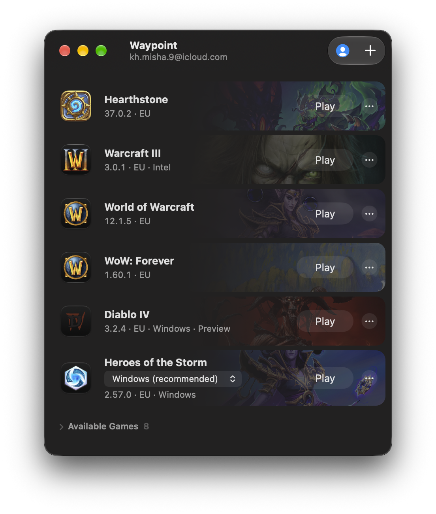
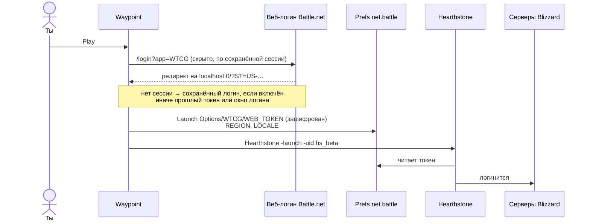

<div align="center">


# Waypoint

**Battle.net без лишнего для маков с Apple Silicon.**<br>Устанавливает, обновляет и запускает игры Blizzard без приложения Battle.net. Сам лаунчер работает нативно. Просто жмёшь Play.

<a href="https://github.com/wowlocal/waypoint-launcher/releases/latest"></a>

[](https://github.com/wowlocal/waypoint-launcher/releases/latest) [](#сборка) [](#зачем) [](#сборка) [](#дисклеймер)



[English](README.md) · **Русский**

</div>

---

## Зачем

От лаунчера нужны установка, обновления и вход в игру. Waypoint делает это в нативном окне на Swift и AppKit, скачивает файлы прямо у Blizzard и позволяет играть без приложения Battle.net и его Agent.

Сам лаунчер работает на Apple Silicon. Игры для Mac запускаются своими исполняемыми файлами, а поддерживаемые Windows-версии — через отдельный компонент Wine. У каждой игры остаются свои требования к macOS, Rosetta и аккаунту.

| | Waypoint |
|---|---|
| Архитектура | Нативный arm64, AppKit |
| Размер приложения | **9,6 МБ**; загрузка — около 4,5 МБ |
| Компоненты Windows | Скачиваются по запросу и используются повторно |
| Значок в строке меню | По умолчанию выключен, включается в настройках |

## Возможности

- **Вся библиотека в одном окне.** Установленные игры находятся над раскрывающимся списком **Available Games**. Установить игру можно оттуда или через **+**. Обложки и иконки берутся из каталога Blizzard; выключение **Show game artwork** в настройках скрывает их и удаляет скачанные изображения.
- **Установка, обновление и проверка файлов.** Загрузка прямо у Blizzard, обновление установок обоих лаунчеров и **Verify Files** для восстановления отсутствующих или повреждённых данных. Уже выбранные необязательные пакеты, например текстуры HighRes у WoW, сохраняются.
- **Загрузки можно оставить и продолжить.** Установки, обновления и смена языка переживают выход, сбой и обновление самого Waypoint. В строке игры есть пауза и продолжение; в настройках — общий лимит скорости. Можно запретить автоматический сон на время загрузки. Наведи указатель на прогресс, чтобы увидеть скорость, точные объёмы и оставшееся время.
- **Вход один раз на игру.** Через официальный веб-логин Battle.net, включая двухфакторную аутентификацию. У каждого аккаунта свои сохранённые входы. Можно переключиться на другой аккаунт или выбрать **Play As** для одного запуска; логин и пароль при желании сохраняются в Keychain.
- **Windows-версия Heroes of the Storm.** На поддерживаемых маках она рекомендуется по умолчанию; macOS-версия выбирается в той же строке. Используется бесплатный компонент Wine, CrossOver не нужен. Для Windows HotS требуются Rosetta и macOS 15+.
- **Другие Windows-игры в Preview.** Overwatch, Diablo IV и Diablo II: Resurrected используют ту же библиотеку и веб-логин. Нужны Apple Silicon, Rosetta и macOS 26.5+. Wine и графические компоненты скачиваются по запросу; перед установкой графики нужно принять её лицензию. Что проверено и какие есть ограничения — ниже.
- **Выбор языка.** Язык текста и озвучки выбирается при установке или меняется позже через **Change Language…**. У WoW можно выбрать их отдельно.
- **Управление файлами игр.** Меню **…** открывает игру в Finder или папку AddOns у WoW. **Uninstall…** переносит файлы игры в Корзину и позволяет оставить аддоны, настройки и сохранения. Версии WoW в общей папке удаляются по отдельности.
- **Поиск игр и новых релизов для Mac.** Waypoint читает установки Battle.net и сканирует папки игр. Из каталога Blizzard берутся актуальные версии для Mac, названия, папки и параметры запуска, в том числе для новых версий WoW. Каталог сохраняется для работы без интернета. Для завершённых нативных установок отсутствующие записи Battle.net восстанавливаются в фоне, чтобы он тоже распознавал эти игры.
- **Небольшой нативный интерфейс.** Сканирование библиотеки, восстановление метаданных и подготовка обложек работают в фоне. Большие манифесты и индексы загрузок читаются с диска, а не целиком в память. Файлы игр и передача логина следуют форматам Blizzard.
- **Тихое самообновление.** [Sparkle](https://sparkle-project.org) скачивает новые версии Waypoint в фоне и устанавливает их при выходе. Внизу окна доступна кнопка **Restart to Update**. Быстрый запуск из строки меню включается в настройках (⌘,).

## Поддерживаемые игры

Статусы основаны на локальных логах использования и проверках релизов по **11 ноября 2026 года**. ✅ — операция проверена; 🧪 — доступна, но ещё требует проверки. Проверка запуска подтверждает старт игры, а не все игровые сценарии. Windows-профили Preview сохраняют этот статус, даже если установка или обновление уже прошли успешно.

| Игра | Установка | Запуск | Обновления |
|---|---|---|---|
| Hearthstone | ✅ Через Waypoint | ✅ Нативно | ✅ Через Waypoint |
| Warcraft III: Reforged | ✅ Файлы сверены с Battle.net | ✅ Через Rosetta | ✅ На настоящей новой сборке |
| WoW: Retail | ✅ Полная установка | ✅ Нативный запуск | ✅ Несколько новых сборок |
| WoW: Forever | ✅ Полная установка | ✅ Нативный запуск | ✅ Несколько новых сборок |
| WoW: Classic Era | ✅ Установка проверена во временной папке | 🧪 Ещё не проверено | 🧪 Ещё не проверено |
| WoW: Classic, Anniversary | 🧪 Ещё не проверено | 🧪 Ещё не проверено | 🧪 Ещё не проверено |
| Heroes of the Storm (macOS) | 🧪 Полная установка ещё не проверена | ✅ Запуск проверен | 🧪 Ещё не проверено |
| Heroes of the Storm (Windows) | 🧪 Полная установка ещё не проверена | ✅ Запуск через Wine/DXMT проверен | 🧪 Ещё не проверено |
| StarCraft II, StarCraft: Remastered, Diablo III | 🧪 Ещё не проверено | 🧪 Ещё не проверено | 🧪 Ещё не проверено |
| Overwatch (Windows Preview) | ✅ Полная установка | 🧪 Проверены вход, отрисовка и полный экран Retina; остановились на SMS Protect | 🧪 Ещё не проверено |
| Diablo IV (Windows Preview) | ✅ Полная установка | 🧪 Проверены вход и вступительный ролик; геймплей и производительность ещё не проверены | ✅ На настоящей новой сборке |
| Diablo II: Resurrected (Windows Preview) | 🧪 Ещё не проверено | 🧪 Ещё не проверено | 🧪 Ещё не проверено |

<details>
<summary><b>Завершённые обновления на настоящие новые сборки</b></summary>

Это завершённые обновления из логов использования Waypoint, а не пробные планы загрузки или починка той же сборки:

| Игра | Завершённое обновление | Дата |
|---|---|---|
| WoW: Retail | `12.1.5.70448 → 12.1.5.70529`, затем `70688` и `70783` | 23 октября — 4 ноября 2026 |
| WoW: Forever | `1.60.1.70790 → 1.60.1.70862 → 1.60.1.70888` | 7–11 ноября 2026 |
| Warcraft III | `3.0.0.24268 → 3.0.1.24371` | 10 ноября 2026 |
| Diablo IV (Windows) | `3.2.3.73883 → 3.2.4.74043` | 11 ноября 2026 |

WoW Retail и Forever также неоднократно запускались. У Classic Era есть завершённая проверка установки, но более поздняя незавершённая загрузка не считается успешным обновлением. Завершение обновления игры само по себе не подтверждает её геймплей или производительность.

</details>

Требования Blizzard к владению игрой и аккаунту сохраняются, включая SMS Protect в Overwatch, когда он требуется. Изменения и предыдущие проверки описаны в [заметках к релизам](https://github.com/wowlocal/waypoint-launcher/releases).

## Скачать

Скачай **Waypoint-x.y.z.dmg** из [Releases](https://github.com/wowlocal/waypoint-launcher/releases/latest), открой и перетащи Waypoint в «Программы». Релизы подписаны Developer ID и нотаризованы Apple, поэтому приложение открывается без предупреждений.

Нужен Mac на Apple Silicon и macOS 14 или новее.

## Сборка

Нужны macOS 14+ и Xcode со Swift 6.

```sh
git clone https://github.com/wowlocal/waypoint-launcher.git
cd waypoint-launcher
./scripts/bundle.sh          # → build/Waypoint.app
open build/Waypoint.app
```

Если хочешь оставить приложение насовсем, перенеси `Waypoint.app` в `/Applications`.

Локальная сборка включает поддержку Windows, если компонент или описание его загрузки подготовлены в `build/windows-runtime-release/distribution`. Как их подготовить — в [инструкции по сборке компонента](tools/wine-runtime/README.md). Без этого компонента локальная сборка поддерживает игры для Mac.

Опубликованные релизы уже содержат описания загрузок. Компонент Windows скачивается при первом Play Windows-игры и используется из проверенного кэша; он не включается в каждое обновление Waypoint. Windows HotS нужны macOS 15+, Apple Silicon и Rosetta. Остальным Windows-профилям нужны macOS 26.5+; они остаются в Preview.

`WINDOWS_EXPERIMENTAL=1` создаёт отдельное приложение для разработки, со своим идентификатором и без публичной ленты обновлений. См. [профили, компоненты и результаты проверок](tools/wine-runtime/WINDOWS-TITLES.md).

<details>
<summary><b>Как выпустить релиз</b></summary>

`scripts/release.sh` прогоняет тесты, собирает приложение и подписывает его Developer ID (hardened runtime). Потом нотаризует приложение и делает staple, упаковывает его в DMG, подписывает, нотаризует и делает staple для DMG тоже. Проверяет результат через Gatekeeper, затем пишет `appcast.xml` для Sparkle и проверяет его подпись EdDSA.

С `--publish` DMG и `appcast.xml` уходят в S3 (`storage.yandexcloud.net/macos-releases/waypoint/`) — это фид обновлений, который читают установленные копии, а DMG дублируется в GitHub Releases. Ключи S3 берутся из `AWS_ACCESS_KEY_ID`/`AWS_SECRET_ACCESS_KEY` или из `scripts/release.env` (в .gitignore).

```sh
# существующий профиль Keychain (скрипт релиза использует его по умолчанию)
export NOTARY_KEYCHAIN_PROFILE=keys-cli-notary
# …или ключ App Store Connect API: NOTARY_KEY=<.p8> NOTARY_KEY_ID=<id> NOTARY_ISSUER=<uuid>

scripts/release.sh 0.1.0             # → dist/Waypoint-0.1.0.dmg + .sha256
scripts/release.sh 0.1.0 --publish   # плюс тег v0.1.0 и GitHub Release

scripts/test-self-update.sh          # сквозной тест: старая сборка обновляет себя с локального фида
```

Обновления подписываются ключом EdDSA, который лежит в Keychain под аккаунтом `waypoint`. Его публичная часть — в `scripts/bundle.sh`. Сделай резервную копию ключа: без него установленные копии не получится обновить.

```sh
.build/artifacts/sparkle/Sparkle/bin/generate_keys --account waypoint -x waypoint-sparkle.key   # экспорт
.build/artifacts/sparkle/Sparkle/bin/generate_keys --account waypoint -f waypoint-sparkle.key   # импорт на другом Mac
```

</details>

## Как пользоваться

1. Открой Waypoint. Игры на диске появятся в библиотеке. Чтобы поставить новую, раскрой **Available Games** и нажми **Install** или используй **+** на панели инструментов.
2. Выбери папку, язык и регион. Окно установки покажет размер загрузки и данные, которые уже есть и могут использоваться повторно.
3. Нажми **Play**. При необходимости откроется веб-логин Battle.net. Каждая игра просит войти один раз на аккаунт; следующие запуски используют сохранённый вход.

Под заголовком окна показан активный аккаунт. Кнопка с человеком позволяет переключить аккаунт, выбрать **Add Account…**, **Sign In Again…** или **Sign Out**. Пункт **Play As** в меню **…** запускает игру один раз от другого аккаунта. Если игра не принимает вход, закрой её и выбери **Sign In Again and Play**.

<details>
<summary><b>Необязательный автоматический вход</b></summary>

Выбери **Save Login in Keychain…** в меню аккаунта или **Save Login…** в настройках, чтобы сохранить его почту/телефон и пароль на этом Mac. Когда у игры нет сохранённого токена, Waypoint один раз попробует эти данные. **Sign In Again and Play** тоже пробует их в новой сессии. Пароли остаются в Keychain и не попадают в настройки или диагностику.

Неверные данные, CAPTCHA и двухфакторная проверка открывают страницу Battle.net, чтобы ты продолжил сам. **Update Saved Login…** заменяет данные и снова включает автоматический вход; **Forget Saved Login** или Sign Out удаляет их. Временные ошибки повторяются с растущими интервалами; после трёх неудач подряд автоматические попытки приостанавливаются. Попытка происходит только при запуске игры, а ограничение сохраняется после перезапуска приложения.

</details>

**Загрузки.** Пауза находится рядом с прогрессом; **Pausing…** показывается, пока запросы и запись файлов не остановятся. Продолжение сохраняет папку, языки, регион и параметры проверки. После выхода или обновления Waypoint незавершённые задачи возвращаются в состоянии **Paused** с сохранённым прогрессом. Временные сетевые ошибки повторяются автоматически. При наведении на прогресс видны недавняя скорость, скачанный и полный объём, остаток и оценка времени, когда она доступна.

Кнопка с чашкой не даёт Mac автоматически уснуть, пока идёт эта загрузка, но экран может погаснуть. У новой загрузки она выключена. Пауза, ошибка или завершение снимают запрет сна; продолжение восстанавливает его, если кнопка осталась включённой. Команда сна и закрытие крышки работают по обычным правилам macOS.

Кнопка **✕** у приостановленной или неудавшейся загрузки убирает её из очереди. Для незавершённой установки, которую можно безопасно убрать, предлагаются **Keep Downloaded Data** и **Move to Trash**. Установленные игры и общие данные защищены; отмена обновления оставляет скачанные данные. При сохранении данных следующая установка в ту же папку сможет использовать их повторно.

**Настройки** (⌘,) позволяют ограничить общую скорость от **250 КБ/с** до **100 МБ/с** или выбрать **Unlimited**. Там же включаются обложки и значок в строке меню. Выключение обложек удаляет скачанные изображения; повторное включение загружает их заново (около 7 МБ).

**Меню … у игры** также предлагает:

- **Play Without Updating**, когда доступно обновление.
- **Verify Files** для проверки и восстановления данных игры.
- **Change Language…** для загрузки нового языка текста или озвучки.
- **Show in Finder** и **Open AddOns Folder** у версии WoW, чья папка уже существует. Они доступны и во время игры.
- **Uninstall…** с подтверждением и возможностью оставить аддоны, настройки и скриншоты WoW или сохранения и настройки Windows-игры. Другие версии WoW остаются установленными; из общего хранилища убираются только данные, которые им больше не нужны.

> [!NOTE]
> Закрой Battle.net и его фоновый Agent перед установкой, обновлением или удалением. Waypoint не допускает одновременную запись в одни и те же файлы игры. Саму игру тоже нужно закрыть перед изменением её файлов.

Для сообщения об ошибке выбери **Help → Export Diagnostics…**. Экспорт содержит состояние установок и недавние логи с удалёнными паролями и токенами аутентификации. **Help → Show Logs in Finder** открывает локальные логи.

## Как это работает

На macOS Battle.net не передаёт игре логин в командной строке. Он записывает зашифрованный токен в preferences-домен `net.battle` и запускает игру, а игра читает токен на старте. Waypoint делает то же самое.



<details>
<summary><b>Подробности</b></summary>

**Preferences** (`~/Library/Preferences/net.battle.plist`)

| Ключ | Значение |
|---|---|
| `Launch Options/<КОД>/WEB_TOKEN` | зашифрованный токен (data) |
| `Launch Options/<КОД>/REGION` | `EU`, `US`, `KR`, `CN` |
| `Launch Options/<КОД>/LOCALE` | `enUS`, `ruRU`, … |

`<КОД>` равен `WTCG` для Hearthstone и `WoW` для всех версий WoW.

**Шифрование.** AES-128-CBC с нулевым IV и паддингом PKCS#7. Ключ — PBKDF2-HMAC-SHA1 (1000 раундов, соль `someSalt`) от фиксированной 16-байтной энтропии, XOR с именем пользователя macOS. Это повторяет `RegistryDarwin` из Battle.net SDK внутри игры. Проверено на токенах, которые записал настоящий Battle.net (`waypoint-cli check-tokens`).

**Токен.** Веб-логин `https://<region>.battle.net/login/en/?externalChallenge=login&app=<КОД>` в конце редиректит на `http://localhost:0/?ST=<токен>`. Токен выглядит как `US-<32 hex>-<id аккаунта>`.

**Аккаунты.** У каждого аккаунта своё постоянное хранилище WebKit (`WKWebsiteDataStore(forIdentifier:)`), поэтому их сессии Battle.net живут рядом. Токен каждого аккаунта для каждой игры хранится в связке ключей и используется при следующих запусках, пока его не потребуется заменить. Переключение аккаунта выбирает его сохранённый вход для игры. BattleTag и почта берутся из JSON API за страницей аккаунта Blizzard (`account.battle.net/api/details`), с сессией этого аккаунта.

**Команды запуска**

| Игра | Команда | Рабочая папка |
|---|---|---|
| Hearthstone | `Hearthstone.app/…/Hearthstone -launch -uid hs_beta` | папка установки |
| WoW | `World of Warcraft.app/…/World of Warcraft -launcherlogin -uid wow` | папка версии (`_retail_`, `_classic_`, …) |
| Warcraft III, StarCraft | `<Game>.app/…/<Game> -launch -uid <uid>` | папка установки (Warcraft III: `_retail_`) |
| StarCraft II, Heroes of the Storm | переключатель игры с `-sso=1 -launch -uid <uid>` | папка установки |
| Diablo III | `Diablo III.app/…/Diablo III OnlineService.SSO=true -launch -uid d3` | папка установки |

Аргументы запуска берутся из конфигурации продукта Blizzard; для работы без сети есть встроенные значения. Windows-игры используют отдельное окружение Wine и небольшой помощник для записи зашифрованных параметров входа; профили и требования к графике описаны [здесь](tools/wine-runtime/WINDOWS-TITLES.md).

Игры запускаются через `posix_spawn` и сами отвечают за себя перед системой, как и при запуске из Battle.net. Поэтому системные запросы разрешений (например, микрофон для голосового чата WoW) приходят от игры, а не от лаунчера.

**Обновления** работают по протоколу доставки контента Blizzard (TACT):

1. Спрашиваем у `https://<region>.version.battle.net/v2/products/hsb/versions`, какая сборка сейчас актуальна.
2. Берём с CDN конфиг этой сборки и *install-манифест*. В нём перечислены все файлы с их MD5 и тегами (платформа, регион, язык, контент).
3. Выбираем файлы по тегам, которые Battle.net записал для твоей установки. Выбор учитывает платформу, регион, языки и необязательные пакеты установки.
4. Сравниваем с манифестом установленной сборки и качаем только файлы, у которых изменился хэш. Если старого манифеста нет, хэшируем локальные файлы (это и делает **Verify Files**).
5. Для каждого файла находим закодированный ключ в таблице *encoding* и место в архивах CDN по их индексам. Скачиваем HTTP range-запросом, распаковываем контейнер BLTE по чанкам и проверяем MD5.
6. Когда все файлы скачаны и проверены, подменяем их, а потом удаляем то, чего в новой сборке больше нет.

Загрузки складываются в `.waypoint-staging` внутри папки игры, поэтому прерванное обновление продолжится с места остановки. Пока игра открыта, обновление не запустится.

**Установка.** Hearthstone хранит файлы как есть, поэтому его установка — это обновление в пустую папку. Все остальные игры держат данные в локальном хранилище CASC (`Data/data`), которое игра читает сама. Waypoint скачивает файлы, которые download-манифест сборки перечисляет для твоей платформы и языка, и пишет архивы `data.###`, 16 индексов `.idx` и `shmem` байт в байт так же, как Battle.net Agent. Само приложение и остальные файлы из install-манифеста кладутся в папку игры как есть, рядом с `.build.info`, `Data/config` и `Data/indices` (все индексы из CDN-конфига и два групповых индекса archive-group, которые Battle.net собирает из них сам, байт в байт как он). Проверочная установка Warcraft III совпала с набором файлов Battle.net, и игра из неё запустилась.

**Обновления этих игр** дописывают файлы новой сборки в то же хранилище, кто бы его ни создал. Ничего из уже лежащего не переносится и не переписывается: новые файлы идут после конца последнего архива, потом в новые; 16 индексов `.idx` пишутся следующей версией, потом `shmem`, и только после этого удаляются старые индексы, так что игра всегда видит целый набор. Прерванное обновление продолжается по журналу. Файлы как есть обновляются так же, как у Hearthstone. После обновления из хранилища убирается то, что не нужно ни одной установленной сборке (например, файлы старой), и место возвращается диску: мёртвый конец архива обрезается, а мёртвые куски внутри вырезаются, и APFS освобождает их на месте, ничего не перемещая. `waypoint-cli cleanup <uid>` делает то же по запросу.

Необязательные пакеты вроде `HighRes` и `Alternate` у WoW скачиваются только тогда, когда их выбирают теги самой установки. Новая установка WoW через Waypoint берёт `HighRes` — это установка в полном качестве; уже существующая установка (сделанная Battle.net или более ранним Waypoint) сохраняет то содержимое, с которым её поставили, поэтому обновление скачивает ровно то же, что скачал бы Battle.net, и никогда не добавляет десятки гигабайт необязательных данных, которые его очистка всё равно удалит. Установка с текущей сборкой считается обновлённой, какие бы пакеты в ней ни были.

**Поиск игр.** Список берётся из `/Users/Shared/Battle.net/Agent/product.db` (protobuf) или из `.product.db` в папке каждой игры, плюс игры, которые установил сам Waypoint. При запуске Waypoint восстанавливает отсутствующие записи Battle.net для завершённых нативных установок, в том числе отдельные записи версий WoW в общей папке. Восстановление ждёт закрытия Battle.net и его Agent, сохраняет существующие записи и исправляет известные старые права во всех вложенных папках данных CASC у WoW и файлах хранилища, чтобы импорт игры не запускал исправление прав с запросом администратора. Новые нативные загрузки CASC тоже подготавливают папки и файлы хранилища для Battle.net.

</details>

## Командная строка

```sh
xcrun swift run waypoint-cli list            # установленные игры и работают ли они нативно
xcrun swift run waypoint-cli catalog --refresh  # получить список доступных игр у Blizzard
xcrun swift run waypoint-cli plan hs_beta    # dry run: как будет запущена игра
xcrun swift run waypoint-cli check-tokens    # проверка шифра на токенах от Battle.net
xcrun swift run waypoint-cli check-updates   # установленная версия против актуальной
xcrun swift run waypoint-cli update hs_beta --dry-run           # что скачает обновление
xcrun swift run waypoint-cli update w3 --dry-run                # то же для игры с хранилищем CASC
xcrun swift run waypoint-cli cleanup w3 --dry-run               # что уберёт чистка её хранилища
xcrun swift run waypoint-cli update hs_beta --verify --dry-run  # проверить хэши всей установки
xcrun swift run waypoint-cli fetch hs_beta '^Strings/' /tmp/hs  # скачать файлы в другую папку
xcrun swift run waypoint-cli install w3 /Applications/Warcraft\ III --dry-run  # что скачает установка игры
xcrun swift run waypoint-cli launch w3        # запустить установленную игру
xcrun swift test
WAYPOINT_NETWORK_TESTS=1 xcrun swift test --filter liveUpdate  # настоящее обновление 36.6.0 → актуальная, во временной папке
```

## Планы

- [x] Установка, запуск и обновление Hearthstone, Warcraft III, WoW Retail и WoW: Forever
- [x] Обновления CASC на настоящие новые сборки, включая Diablo IV на Windows
- [x] Запуск Windows Heroes of the Storm через бесплатный компонент Wine
- [x] Windows-профили Overwatch, Diablo IV и Diablo II: Resurrected в Preview
- [x] Несколько аккаунтов и входов на игру, с необязательным логином в Keychain
- [x] Продолжение загрузок после перезапуска, пауза, лимит скорости и запрет сна
- [x] Смена языка, восстановление файлов и удаление отдельных версий WoW
- [x] Новые версии игр для Mac и обложки из каталога Blizzard
- [x] Нативная библиотека на AppKit, подписанные и нотаризованные релизы, тихое самообновление
- [ ] Проверить запуск и обновления на новые сборки остальных версий WoW Classic
- [ ] Проверить полную установку с нуля и обновления на новые сборки обеих версий HotS
- [ ] Полностью проверить StarCraft II, StarCraft: Remastered и Diablo III
- [ ] Проверить геймплей Overwatch после требований аккаунта и SMS
- [ ] Проверить геймплей и длительную производительность Diablo IV
- [ ] Проверить установку, запуск и обновления Diablo II: Resurrected

## Дисклеймер

Waypoint — неофициальный фанатский проект. Он не связан с Blizzard Entertainment и не одобрен ею. Blizzard, Battle.net, Hearthstone, World of Warcraft, Warcraft, StarCraft, Diablo и Heroes of the Storm — торговые марки Blizzard Entertainment, Inc.

Blizzard официально не поддерживает запуск игр в обход Battle.net. Этот подход используют годами (см. Благодарности), но гарантий нет, и Blizzard может в любой момент изменить способ передачи логина. Используй на свой риск.

## Благодарности

- [hearthstone-linux](https://github.com/0xf4b1/hearthstone-linux): шифрование токена и веб-логин
- [BnetTokenator](https://github.com/InvoxiPlayGames/BnetTokenator): структура `Launch Options`
- [TACTLib](https://github.com/overtools/TACTLib): схема `product.db`
